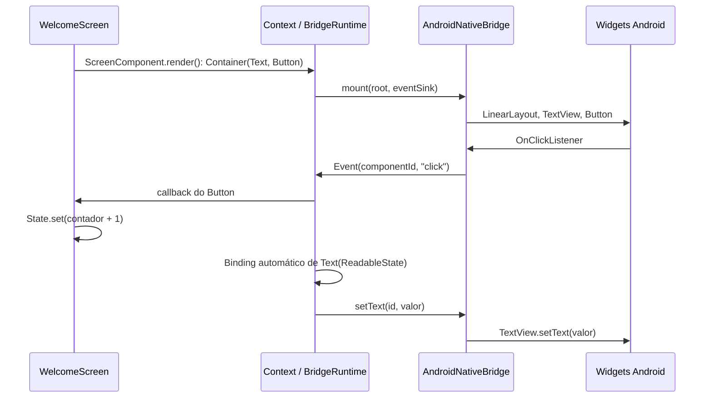

# Arquitetura e Bridge



## Contrato

`mount` recebe uma árvore declarativa e o destino dos eventos nativos.
`setText` envia uma atualização identificada por ID. `close` descarta a montagem.
`Event` transporta o ID do componente e o nome do evento. Nesta etapa só existe `click`.
Os IDs são internos e gerados automaticamente. O runtime impede que a mesma
instância de componente seja montada em dois lugares na mesma árvore.
Eventos com ID/nome desconhecido são ignorados.

Os objetos atravessam uma interface Java no mesmo processo/thread. A inspiração
no modelo de bridges está na separação de responsabilidades e no fluxo de
comandos/eventos; não existe uma bridge JS/JNI ou o protocolo do React Native.

## Declaração da tela

```java
new Container(new ContainerProps().paddingAll(20)).children(
    new Text("Hello World", new TextProps().fontSize(50)),
    new Text(clicks.map(value -> "Cliques: " + value)),
    new Button("Clique aqui")
        .onClick(() -> clicks.set(clicks.get() + 1))
);
```

`WelcomeScreen` implementa `ScreenComponent.render()`. `Main` configura o tema e
chama `MegalodonteApp.run(context -> context.useView(new WelcomeScreen()))`.
O runtime monta a árvore e assina automaticamente os estados dos Texts.
Props são resolvidos pelo renderer, com dimensões em dp e fontes em sp.
A tela não conhece IDs nem comandos da bridge. Veja [CLIENT_API.md](CLIENT_API.md).
Não há diff: `context.useView` descarta a árvore anterior e monta a nova tela.

## Ciclo de vida

`MainActivity` estende `MegalodonteActivity` e apenas chama `Main.main()`.
O host cria bridge/Context e mantém um contexto de inicialização por thread para
`MegalodonteApp.run`. O Context chama `restoreState`, `render` e `onMount`.
Na recriação, o host recupera o mapa salvo pela tela no Bundle. Ao destruir a
Activity ou trocar de tela, o runtime fecha bindings/views e chama `onDestroy`.

O State comum fornece observe/unsubscribe. O runtime guarda Subscription dos
bindings/tema e fecha todos no descarte. MappedState só observa a fonte enquanto
há assinantes. ComputedState/ForEachState devem ser fechados pelo dono quando
suas fontes são mais longevas que a tela. Os novos controles usam setValue e
eventos com payload de texto/boolean/progresso/visibilidade.

Estado/tema/contratos vêm do mesmo core consumido pelo JavaFX. A topologia e as
diferenças estão em [LIBRARY_ANALYSIS.md](LIBRARY_ANALYSIS.md).

## Evolução

Extrair componentes/estado compartilháveis entre desktop e Android, adicionar props
neutros, mais componentes, contrato de atualização e testes instrumentados.
Os fontes originais Main/WelcomeScreen do app1-welcome são compilados como fixtures
contra os pacotes clássicos Android e executados por uma bridge de teste.
Uma fila assíncrona ou serialização só deve entrar quando houver necessidade de
separar runtimes; isso demandará regras de ordenação, erros e descarte.
