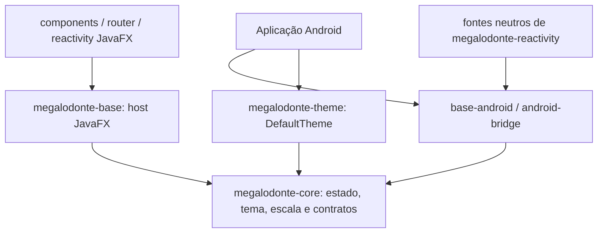

# Análise das Bibliotecas e Contrato Multiplataforma

## Estado desta entrega — 2026-10-06

O MVP foi validado pelo usuário. Esta entrega extrai a primeira camada comum real,
reutiliza o tema como dependência Gradle e amplia a UI Android. **Ainda não há
paridade completa com todas as funcionalidades do JavaFX.** O inventário cobre
os fontes de produção de todas as bibliotecas e torna as lacunas verificáveis.

## Resultado da inspeção

| Biblioteca original | O que é neutro | Acoplamento encontrado | Tratamento |
| --- | --- | --- | --- |
| base | State, ReadableState, ForEachState, tokens/contrato de tema, políticas de escala | Component/Props envolvem Node; ThemeManager usa Scene; ScaleProvider usa Screen; Scope depende de Async virtual/SLF4J/ErrorReporter | Estado e tema extraídos; serviços de escala/fontes injetados; lifecycle e matcher de rotas comuns |
| theme | DefaultTheme e valores semânticos | Dependência transitiva de base e bytecode Java 25 | Agora depende somente do core, compilada com release 17 e consumida por ambos |
| reactivity | ComputedState, ListState, ForEachState e ListenerManager | Show envolve VBox/Animation; plugin e módulo JPMS dependem de JavaFX | Base Android compila diretamente os quatro fontes neutros; Show tem adapter Android próprio |
| router | Matching de segmentos/parâmetros | RouterBase expõe Stage; factories e ScreenManager dependem de contextos/janelas JavaFX | Matcher extraído e usado pelo desktop; navegação Android completa continua pendente |
| components | Formatação, dados de tabela, definições de props e reconciliação podem ser separados | Views, CSS, enums geométricos, Node, imagens/ícones nativos e eventos JavaFX aparecem no cliente/props | Adapters Android para um subconjunto; próxima extração deve ser de modelos/contratos, não cópia das skins |

`megalodonte-theme` parecia independente, mas seu grafo puxava toda a base JavaFX.
Os tokens de fonte/espaçamento chamam ScaleProvider nos acessores. Portanto não
bastava remover um import: foi necessário trocar a dependência e separar a
detecção de escala da política comum.

## Topologia implementada

O core é um JAR publicável com os nomes/pacotes originais de estado e tema. Não há
segunda implementação desses tipos dentro do Android. Seu module-info só exporta
pacotes neutros; base requer core transitivamente e não volta a exportar pacotes
movidos. Isso evita split packages no JPMS desktop.

Reactivity ainda mistura tipos neutros e Show no mesmo repositório. O Android
compila somente os quatro fontes neutros originais dentro de
`megalodonte-base-android`, sem publicar um segundo artefato e sem fork de código.
O JAR Desktop completo não entra no APK. A separação física definitiva dos
modelos e do adapter Show ainda exige reorganização de pacotes.

## Garantias atuais do contrato

1. **Tipos únicos:** ThemeInterface, tokens, State, ReadableState e Subscription
   pertencem ao mesmo artefato consumido pelos dois backends.
2. **Versão/capacidades:** BackendContract valida a versão 1 e declara funcionalidades.
   `context.backendContract()` existe nos dois hosts. O runtime Android exige a
   capacidade de cada categoria antes de montar os componentes conhecidos.
3. **Lifecycle:** ScreenComponent nos dois backends estende ScreenLifecycle.
4. **Semântica comum:** map suprime resultados iguais, observe retorna descarte
   idempotente; matcher prioriza rotas literais e rejeita empate ambíguo.
5. **Build:** check do core verifica imports proibidos e bytecode até Java 17.
   O app Android verifica seu grafo contra jars desktop/JavaFX.
6. **Clientes reais:** os fontes originais dos apps 1 a 4 são compilados e executados
   contra a API Android, sem alterações, em source sets separados.

Capacidade é uma categoria de funcionalidades, **não uma certificação de todos
os overloads/props legados dessa categoria**. A superfície suportada está em
[COMPATIBILITY.md](COMPATIBILITY.md). O contrato de UI ainda não unifica todas as
classes Component/Props dos dois adapters; a análise não apresenta isso como pronto.

## Matriz e inventário reproduzível

`scripts/audit-libraries.ps1` gera [library-inventory.json](library-inventory.json),
com tipos, imports de plataforma, dependências internas e declarações públicas.
São 133 tipos na inspeção atual, incluindo classes de exemplo dentro de src/main.
A classificação distingue artefato compartilhado, fonte reutilizado, adapter
Android parcial, adapter necessário e candidato neutro que ainda exige inspeção
transitiva. A regex de declarações é auxiliar; não substitui compilação nem uma
análise semântica completa de Java.

## Refatorações necessárias para a paridade completa

### Component e Props

Hoje ComponentInterface promete `getJavaFxNode/fromJavaFxNode` e PropsInterface
recebe Node. Esses são contratos JavaFX, não contratos gerais. O próximo corte
deve separar descrição de componente/propriedades de `NativeComponent<N>` e
`NativeRenderer<N>`, mantendo os nomes clássicos como facades dos adapters.
Slots, filhos, refs, eventos e propriedades reativas precisam de schema comum e
testes por método. CSS arbitrário e Node nativo devem ser capacidades exclusivas.

Props de layout misturam dados com aplicação de estilo e enums JavaFX. Extrair
Padding/Spacing/Size/Alignment e TextStyle para modelos neutros; adapters traduzem
dp/sp e CSS. O Android atual cobre somente os métodos explicitamente listados.
Não implementar overloads que aceitam Node/Insets/Pos como no-ops.

### Rotas e trabalho assíncrono

RouteTable já delega ao matcher genérico comum. ScreenFactory ainda recebe um
ScreenContext com Stage/Scene e RouterBase ainda navega em Stage. Separar
Navigator/RouteParams/ScreenFactory neutros de DesktopWindowHost. SpawnWindow,
dimensões de janela e resizable devem exigir capacidade desktop; não fingir que
abrir uma Activity equivale ao mesmo contrato de janela.

Async usa `newVirtualThreadPerTaskExecutor`, indisponível no Android. Separar
TaskExecutor e UiDispatcher; JavaFX mantém threads virtuais e Platform.runLater,
Android fornece executor/Handler. Scope pode então compartilhar cancelamento e
limpezas. ErrorReporter precisa de um destino de logs injetável: `user.home` não
é um contrato válido para arquivos privados Android. Essas migrações ainda não
foram feitas.

### Componentes compostos e recursos

- **SimpleTable/PaginatedTable:** extrair TableModel, coluna, seleção, paginação e
  snapshot de exportação. ObservableList/TableView/edição de células são adapters.
- **Select/DatePicker:** compartilhar opções, comparadores, display mapper e
  LocalDate; implementar dropdown/calendário nativos e eventos bidirecionais.
- **CurrencyInput:** extrair formatador/valor bruto das regras de caret e TextField.
- **ForEachState/items:** reconciliação já é reutilizável; inserção/remoção de subárvores
  precisa desmontar bindings do subtree, não remontar toda a tela.
- **Show/animações:** condições simples já funcionam; Transition que retorna
  javafx.Animation deve virar AnimationSpec neutro e executor de cada backend.
- **Menu/Modal/Grid/Flow/Canva/Stack:** modelos, ancoragem, foco e back/dismiss precisam
  de políticas próprias antes de certificar paridade, especialmente no mobile.
- **Image/Icon/fontes:** separar identificador/recurso de javafx.Image/Node e
  Typeface/Drawable. O tema é comum; descoberta de fontes e assets é específica.

## Compatibilidade e migração

- Compilar o ecossistema na nova ordem: core, base, reactivity, theme,
  router e components. `install-all` já inclui os novos artefatos.
- Recompilar consumidores desktop: tipos mudaram de módulo. O helper transitório
  `ThemeManager.applyFontFamily(Object)` preserva chamadas de fonte, mas não o
  descritor binário antigo `applyFontFamily(Scene)`.
- Bootstrap instala JavaFxPlatform antes de fontes/estilos. Chamadas explícitas
  de FontLoader fora desse bootstrap precisam instalar o adapter primeiro.
- Android usa escala lógica 1; conversões dp/sp ficam no renderer, evitando
  multiplicar densidade duas vezes. Overrides do ScaleProvider continuam comuns.
- A versão Maven beta foi mantida para o desenvolvimento local. Antes de distribuir
  externamente, versionar o conjunto, registrar essa migração e publicar os contratos
  de API. Os novos módulos ainda pertencem ao repo umbrella, não a novos submódulos Git.

## Validação e limites

Core, tema e reatividade portátil possuem checks executáveis. Todos os módulos
desktop recompilaram; isso não equivale a testar suas telas em execução. Os quatro
clientes clássicos passaram contra a bridge de teste, e o APK/lint Android passaram.
Não havia dispositivo no início; um emulador existente foi iniciado sem janela,
com boot limpo/GPU por software. A instrumentação passou em API 37 para cliente,
input formatado, checkbox, progresso, Show, tema reativo e descarte de listeners.
Validar especificamente em Android 15/API 35 e os casos de layout/rotação restantes.
A expansão completa continua
descrita em TODO e na matriz, sem tratar pendências como capacidades entregues.
